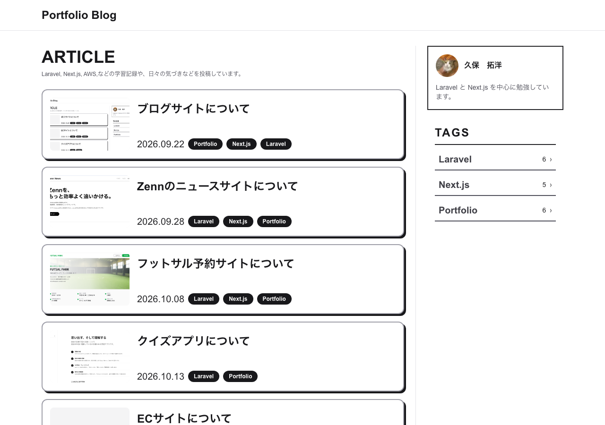
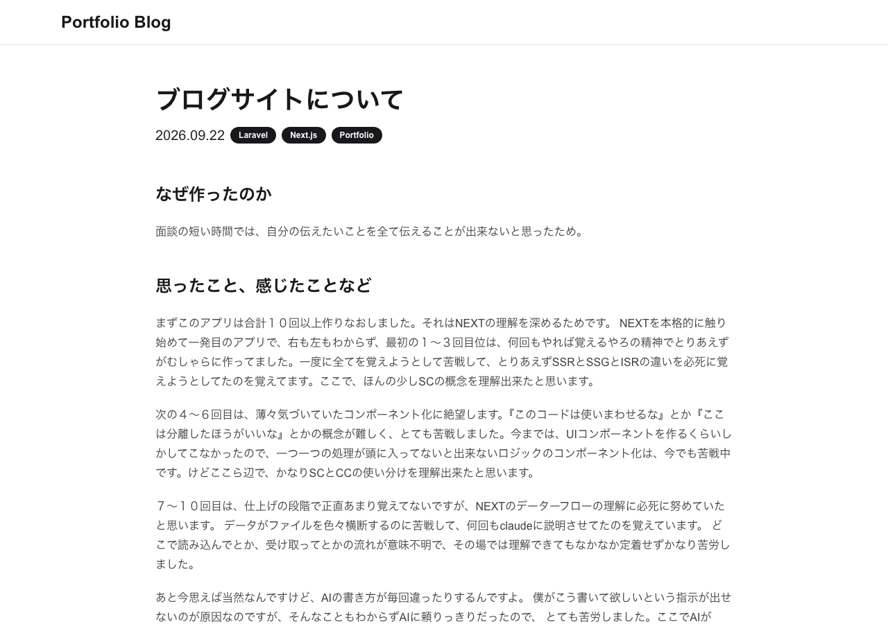

# Portfolio Blog

Laravel（API） + Next.js（App Router）構成のシンプルなブログアプリです。
ポートフォリオとして、設計・実装からテスト・本番デプロイまで一通り自分で行いました。

## デモ

- 公開ページ: https://frontend-production-2c45.up.railway.app
- 管理画面: https://frontend-production-2c45.up.railway.app/login（ログイン情報は面接時にお伝えします）

## スクリーンショット

| 記事一覧 | 記事詳細 |
|---|---|
|  |  |

## 主な機能

- 記事（Markdown）・タグの管理（作成・編集・削除、タグによる絞り込み）
- サムネイル画像のアップロード
- 管理者ログイン（Sanctum SPA Cookie認証、ログイン試行のレート制限つき）
- 公開ページはSSR+ISR、管理操作後は即時キャッシュ再検証
- 投稿の所有者のみが編集・削除できる認可（Policy）

意図的にスコープ外にしたもの: コメント、いいね、ページネーション、検索、新規登録・パスワードリセット

## 技術スタック

| 層 | 技術 |
|---|---|
| バックエンド | Laravel 13 / PHP 8.3+ / Laravel Sanctum（SPA Cookie認証）/ PostgreSQL / Pest / Laravel Pint |
| フロントエンド | Next.js 16（App Router）/ React 19 / TypeScript / Tailwind CSS / react-hook-form + zod / react-markdown / Jest + Testing Library |
| ストレージ | Railway Buckets（S3互換オブジェクトストレージ、署名付きURLで配信） |
| インフラ | Railway（Dockerfileビルド、GitHub連携による自動デプロイ）/ Docker Compose（ローカル）/ GitHub Actions（CI） |

## アーキテクチャ

```
backend/    Laravel — ビューを持たない純粋なJSON API
frontend/   Next.js（App Router）
docker-compose.yml  ローカル開発用
```

- バックエンドとフロントエンドは完全に分離した別プロセス。本番はRailwayにそれぞれ個別デプロイ。
- 公開ページ（`/`, `/posts/[slug]`）はServer Component + オンデマンドISR（`revalidate: 7200`、管理操作後は`/api/revalidate`で即時再検証）。
- 管理画面（`/admin/**`）はCookie認証状態に依存する動的データのため完全にCSR。
- **本番のbackend/frontendは別ホスト名（`*.up.railway.app`）で動いており、独自ドメインも無いため、CookieをフロントエンドのJSから読む手段がない**（`document.cookie`は同一ホスト名のCookieしか見えない）という制約があった。これをNext.jsの`rewrites()`で`/api`・`/sanctum`をバックエンドへ透過プロキシし、ブラウザからは常に同一オリジンに見える構成にすることで解決している（詳細は`frontend/next.config.ts`）。

## ディレクトリ構成（抜粋）

```
backend/
  app/Http/Controllers/        公開API・管理API（Admin配下）
  app/Policies/                PostPolicy（所有者ベース認可）
  app/Models/                  Post, Tag, User
  database/migrations/
  tests/Feature/                Pestによる機能テスト

frontend/
  app/(public)/                 公開ページ（SC + ISR）
  app/admin/                    管理画面（CSR）
  app/api/revalidate/           ISR再検証用Route Handler
  components/ui/                Button, Card, Pill などの共通UI
  lib/public/, lib/admin/       公開側・管理側それぞれのAPIクライアント
  tests/                        Jest + Testing Library
```

## ローカル開発環境のセットアップ

```bash
git clone https://github.com/kabochan73/Portfolio-Blog2.git
cd Portfolio-Blog2

cp backend/.env.example backend/.env
# ADMIN_EMAIL, ADMIN_PASSWORD を編集（APP_KEYは次のkey:generateが自動生成）

docker compose up -d
docker compose exec backend php artisan key:generate
docker compose exec backend php artisan migrate --seed
```

- 公開ページ: http://localhost:3000
- バックエンドAPI: http://localhost:8000

## テスト

```bash
# バックエンド（Pest, 38 tests）
docker compose exec backend vendor/bin/pest
docker compose exec backend vendor/bin/pint --test   # コードスタイル

# フロントエンド（Jest, 49 tests）
docker compose exec frontend npx jest
docker compose exec frontend npm run lint
docker compose exec frontend npx tsc --noEmit
```

## CI/CD

- GitHub Actions（`.github/workflows/`）: push・PR時にバックエンド（Pint + Pest）、フロントエンド（ESLint + tsc + Jest + build）をそれぞれ実行
- デプロイはRailwayのGitHub連携により、`main`へのpushをRailwayが直接検知してDockerfileビルド・デプロイを行う
